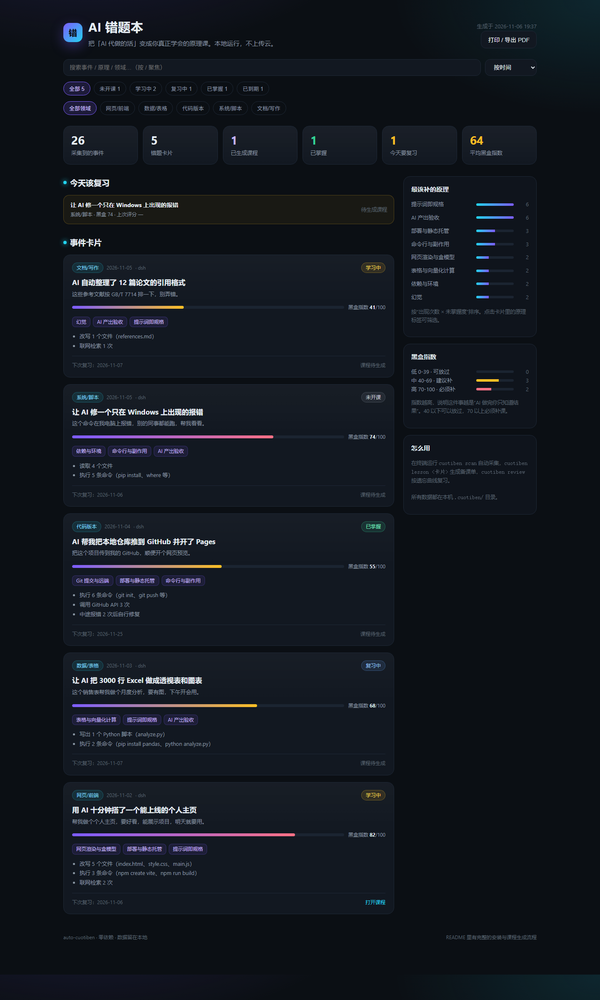

<div align="center">

# AI 错题本 · auto-cuotiben

**Your AI got the work done. Do you actually understand it?**

A local, zero-dependency agent skill that turns your real AI sessions
(DSH / Codex / Claude Code) into mistake cards, generates 15-minute lessons
that teach the underlying principles, and schedules spaced-repetition review.

[中文](README.md) · [Live demo](https://razoredge-wyh.github.io/auto-cuotiben/) · [Sample lesson](examples/lessons/2026-11-02-web-demo.md)

[](https://github.com/RazorEdge-wyh/auto-cuotiben/actions/workflows/ci.yml)
[](LICENSE)
[](https://nodejs.org/)

</div>

---

## The problem

People increasingly get results with AI without learning what happened underneath:
a website in ten minutes, an Excel analysis in one prompt, a bug fixed by copy-paste.
The output looks fine, but the knowledge never transfers — next week you ask the same
thing again.

Generic AI courses don't help because they use examples unrelated to your work.
Your sessions do contain your real work. **auto-cuotiben connects the two.**

## What it does

```text
 local transcripts            distill                 teach                    review
 DSH / Codex / Claude  ──▶  event cards  ──▶  lesson brief  ──▶  lesson + quiz  ──▶  SM-2
                            blackbox index     28 principles      7-part lesson    weekly report
```

1. **Capture** — reads local transcript files (read-only, no plugins, no network).
2. **Distill** — turns each real "AI did the work" turn into a card, scores a
   **Black-box Index** (0-100: how much the AI decided without you being able to verify it)
   and maps it to a principle library.
3. **Teach** — emits a lesson brief with the actual files/commands of the event,
   the mapped principles, a fixed 7-part structure, and a quality checklist.
4. **Verify & review** — `cuotiben lint` mechanically checks the lesson (runnable
   experiment, ≥3 quiz questions, no slop), then SM-2 schedules reviews.

## Quick start

```bash
npm i -g github:RazorEdge-wyh/auto-cuotiben

cuotiben init
cuotiben scan --since 30d          # reads ~/.dsh, ~/.codex, ~/.claude
cuotiben list
cuotiben lesson <card-id>
cuotiben install-skill --target both   # DSH + Claude Code
```

Then tell your agent: *"open my AI mistake book and teach me what I actually did."*

## Highlights

- **Evidence-based, not generic**: lessons are built from your real files, commands and errors.
- **Black-box Index**: quantifies "it works but I don't know why".
- **28 principles across 7 layers**: tokenization, attention, hallucination, RAG, tool calling,
  sandboxing, Git, static hosting, testing, evaluating AI output, and more.
- **Mechanically checkable lessons**: 7 required sections, a runnable 5-minute experiment,
  3+ quiz questions with answers — slop gets rejected.
- **Spaced repetition + weekly "cognitive debt" report**.
- **Privacy by design**: everything local; secrets, emails and bearer tokens are redacted before storage.
- **Zero dependencies**, Node ≥ 22.15 (built-in zstd), no API key.

## Screenshot



## How it differs

| Approach | Tied to your real work | Verifiable | Review scheduled |
| --- | --- | --- | --- |
| AI courses / videos | No | No | No |
| Ask AI to explain once | Yes | No | No |
| Your own notes | Yes | Self-discipline | Self-discipline |
| **auto-cuotiben** | **Yes, from transcripts** | **linter + quiz** | **SM-2** |

## Privacy

Read-only access to local session files. No network calls. Credentials, bearer tokens and
e-mail addresses are redacted before anything is written to `.cuotiben/`.

## Development

```bash
node --test      # 25 tests
npm run demo     # regenerate docs/index.html
```

## License

[MIT](LICENSE) © 2026 王越豪 (RazorEdge-wyh)
