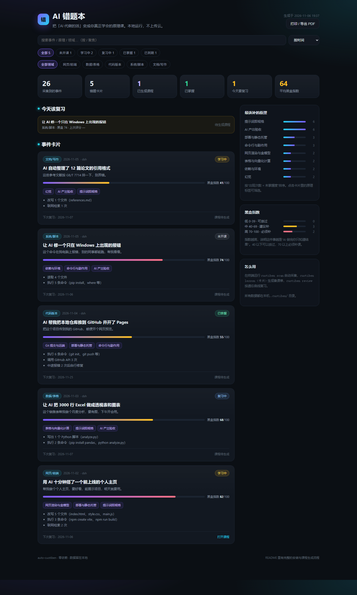

<div align="center">

# AI 错题本 · auto-cuotiben

**AI 把活干完了，你真的会了吗？**

自动读取你本机和 AI 的会话记录，把「AI 代做的活」变成错题卡，
再生成一节 15 分钟、能亲手验证的底层原理课，并按遗忘曲线安排复习。

本地运行 · 零依赖 · 不联网 · 不需要 API Key

<br />

[](https://razoredge-wyh.github.io/auto-cuotiben/)
[](examples/lessons/2026-11-02-web-demo.md)
[](https://github.com/RazorEdge-wyh/auto-cuotiben/actions/workflows/ci.yml)
[](LICENSE)
[](https://nodejs.org/)
[](#)
[](https://github.com/RazorEdge-wyh/auto-cuotiben)

**中文** · [English](README.en.md)

</div>

---

## 为什么做这个

用 AI 干活的人，普遍卡在同一组循环里：

| 场景 | 你得到了 | 你没得到 |
| --- | --- | --- |
| 让 AI 十分钟做了个主页 | 一个能打开的网址 | 浏览器怎么把 HTML/CSS 变成页面、上线到底做了什么 |
| 让 AI 跑完一份 Excel 分析 | 一张图和结论 | groupby 为什么比 for 循环快、数据清洗漏了什么 |
| 让 AI 修好一个报错 | 不报错了 | 到底是环境问题还是代码问题、下次怎么自己判断 |

市面上的 AI 课程讲通用原理，和你的真实工作无关；你的 AI 会话记录里有真实工作，但没人整理。
**auto-cuotiben 把两者接起来**：原料来自你真干过的活，成品是能验收、能复习的课。

> 这不是效率问题，是能力迁移问题。AI 替你做的决定越多，你越需要把它们拿回来。

## 一条自动流水线

```text
 本机会话记录                蒸馏                    出课                     复习
┌──────────────────┐   ┌──────────────┐   ┌────────────────────┐   ┌──────────────┐
│ DSH              │   │ 事件卡        │   │ 备课单（带证据）      │   │ SM-2 遗忘曲线 │
│ Codex            │──▶│ 黑盒指数      │──▶│ 讲义 7 个部分         │──▶│ 到期复习      │
│ Claude Code      │   │ 原理映射      │   │ cuotiben lint 验收   │   │ 自评打分      │
└──────────────────┘   └──────────────┘   └────────────────────┘   └──────────────┘
       扫一次只要 2 秒            自动                   AI 来写         每天 15 分钟
```

1. **采集**：只读本机 transcript（DSH / Codex / Claude Code），不装插件、不打点。
2. **蒸馏**：把「一次 AI 替你干活的回合」变成事件卡，算黑盒指数，映射到原理库。
3. **出课**：生成备课单（事件证据 + 对应原理 + 7 段结构 + 质量底线），AI 按单写讲义。
4. **验收与复习**：`cuotiben lint` 机械验收，入库后按评分调度复习，周报看认知负债。

## 亮点

- **自动，但不是瞎记**：只认「人真的让 AI 干了活」的回合——写文件、跑命令、部署、检索；系统提示、定时提醒、后台任务通知全部过滤。
- **黑盒指数**：给每件事算一个 0-100 的「会用不会懂」分数，告诉你哪张卡必须补。
- **28 条原理库 / 7 层**：从 token、注意力、RAG，到 Git、静态托管、测试、验收，每条都带底层机制、可做的实验和自测题。
- **备课单而不是「让 AI 随便写」**：把这次事件的真实文件/命令注入课程骨架，杜绝泛泛而谈的 Wikipedia 式文章。
- **课程可验收**：7 个部分、可执行实验、≥3 道自测题、字数与套话检查，不过关不让入库。
- **课程能变文档**：讲义是标准 Markdown，需要 Word / PPT 时交给 DSH 的 `office-docx` / `office-pptx` 技能；看板可一键打印成 PDF。
- **苏格拉底小测 + 遗忘曲线**：讲完当场测，答错降级重学，答对拉长间隔；21 天后才标「已掌握」。
- **单文件看板**：`cuotiben html` 生成一个可离线打开、可打印成 PDF 的错题本。
- **隐私是设计而不是承诺**：不联网、不传任何数据；密钥、邮箱、Bearer token 在落盘前自动脱敏。

## 快速开始

```bash
# 1）安装（从 GitHub 直装，无需 npm 账号）
npm i -g github:RazorEdge-wyh/auto-cuotiben

# 2）在任意项目里建错题本
cuotiben init

# 3）扫描本机已有的 AI 会话（最近 30 天）
cuotiben scan --since 30d
cuotiben list

# 4）挑一张卡，生成备课单
cuotiben lesson <卡片ID>

# 5）把 skill 装进 AI 助手：它会按备课单写讲义并当场测你
cuotiben install-skill --target both     # DSH ~/.dsh/skills + 项目 .claude/skills
```

然后对 AI 说：**「开个错题本，给我讲讲这次我到底干了啥」**。
它会 `scan → lesson → 写讲义 → lint → save → 小测 → grade`，全程用你自己的真实记录。

终端长这样（示意输出，实际数字取决于你的会话）：

```text
$ cuotiben scan --since 7d
扫描会话记录：dsh、codex、claude · 全部目录 · 最近 7d

  dsh      文件  30 · 有效回合 237
  codex    文件   3 · 有效回合   5

✓ 新增事件 242 个，新增错题卡片 31 张（共 31 张）

这次新记下的「AI 代做」：
  f4bffbb0  [黑盒  72]  帮我做个个人主页，要能展示项目，明天就要用
            网页/前端 · 网页渲染与盒模型 / 部署与静态托管 / 提示词即规格
  9f6ee642  [黑盒  86]  把 main.c 拆分到 hardware 文件夹，每行注释讲明白原理
            系统/脚本 · 文件系统 / 命令行与副作用 / 测试与回归

下一步：cuotiben lesson f4bffbb0 生成备课单
```

## 截图



- [在线看板](https://razoredge-wyh.github.io/auto-cuotiben/)（用示例数据生成，可交互筛选、搜索、打印）
- [示例课程](examples/lessons/2026-11-02-web-demo.md)：从「AI 十分钟做了个主页」讲透 DOM、盒模型、构建产物和静态托管

## 黑盒指数怎么算

它衡量的是**这件事里 AI 替你做了多少你无法验证的决定**，不是难度，也不是你的智商。

| 信号 | 加分 |
| --- | --- |
| AI 直接改写文件（每个 +9，上限 40） | 40 |
| 自动执行多步（每步 +1.5，上限 20） | 20 |
| 产出分散在多个文件（每个 +3，上限 12） | 12 |
| 你没有要求解释过程 | 10 |
| 你没有亲自验收（跑测试/打开预览/对比） | 10 |
| AI 试错多次才做对，过程你没参与 | ≤10 |

- **0-39 低**：可以放过，或者用碎片时间看一遍。
- **40-69 中**：建议补课，尤其是这个领域你还要继续用。
- **70-100 高**：优先补。AI 几乎替你做了全部判断，你只看到了结果。

> 高黑盒指数说明「该补课了」，不说明你笨。它是一张体检表，不是成绩单。

## 原理库：7 层 28 条

| 层 | 讲什么 | 条目（节选） |
| --- | --- | --- |
| 输入层 | 你给 AI 的东西 | 提示词即规格、上下文窗口、分词与计费 |
| 模型层 | 它为什么这样回答 | 下一个词预测、注意力机制、温度、推理模型、幻觉、微调 vs RAG |
| 工具层 | 它怎么真的动手 | 函数调用、沙箱与权限、文件系统、命令行、Git 提交与远端 |
| 检索层 | 它怎么记住和查资料 | 向量与相似度、RAG、记忆与会话状态 |
| 编排层 | 它怎么自己干活 | 智能体循环、子代理隔离、工具定义设计 |
| 交付层 | 产出的东西怎么跑起来 | 网页渲染与盒模型、HTTP 与鉴权、表格与向量化、部署与静态托管、依赖与环境 |
| 质量层 | 怎么验收和防坑 | 测试与回归、密钥与注入、AI 产出验收 |

每条都包含：一句话定义、为什么与你有关、底层机制、AI 替你做的决定、5 分钟实验、常见误解、自测题、术语表。
完整数据见 [`src/data/principles.json`](src/data/principles.json)。

## 课程长什么样

`cuotiben lesson <卡片ID>` 生成备课单，AI 据此写讲义；`cuotiben lint` 按硬指标验收：

```text
$ cuotiben lint examples/lessons/2026-11-02-web-demo.md
课程验收：通过  100/100

  汉字数：1483
  结构：✓ 这件事你让 AI 做了什么  ✓ AI 替你做的决定  ✓ 底层原理拆解
        ✓ 5 分钟亲手验证  ✓ 自测  ✓ 换场景迁移  ✓ 费曼输出
```

验收不通过就不许入库（`--force` 才放行）。讲义结构固定 7 段：

1. 这件事你让 AI 做了什么（只写事实）
2. AI 替你做的决定（≥3 个，含一个会翻车的）
3. 底层原理拆解（落到这次事件的文件/命令上）
4. 5 分钟亲手验证（确切操作 + 预期现象）
5. 自测（概念 / 迁移 / 判断，≥3 题，答案在文末）
6. 换场景会怎样（反例与边界）
7. 费曼输出（三句话讲给外行听）

## 工作方式

所有数据都在项目下的 `.cuotiben/`，纯文本、可审计、可提交进版本库（默认已 gitignore）：

```text
.cuotiben/
├─ config.json       # 配置：扫描哪些工具、每日时长
├─ events.jsonl      # 采集到的「AI 干活」回合
├─ cards.jsonl       # 错题卡：原理映射、黑盒指数、复习状态
├─ state.json        # 增量扫描缓存
├─ index.md          # 错题本索引
├─ lessons/          # 课程讲义（Markdown）
│  ├─ *.brief.md     # 备课单
│  └─ *.md           # 讲义
└─ index.html        # cuotiben html 生成的单文件看板
```

## 支持的工具

| 工具 | 数据来源 | 状态 |
| --- | --- | --- |
| DSH（DeepSeek Harness） | `~/.dsh/sessions/**/session.v4.jsonl.zstd` | ✅ 已实测（含多帧 zstd 解析） |
| Codex | `~/.codex/sessions/**/rollout-*.jsonl.zst` | ✅ 已实测 |
| Claude Code | `~/.claude/projects/**/*.jsonl` + PostToolUse Hook | ✅ 支持，Hook 实时记录 |
| 其他 | 欢迎 PR 适配 transcript 格式 | — |

## 隐私

- 只读本机会话文件，**不发起任何网络请求**（`scan` / `lesson` / `lint` / `save` / `html` 全离线）。
- 落盘前自动脱敏：GitHub token、`sk-`/`ghp_`/`github_pat_`、AWS key、Bearer、密码字段、邮箱、URL 里的账号密码。
- 采集的是「摘要 + 文件路径 + 命令」，不保存完整对话原文。
- `.cuotiben/` 默认在 `.gitignore` 里，不会被误提交。

## 和别的方案的区别

| 方案 | 和你真实工作的关系 | 是否可验收 | 是否安排复习 |
| --- | --- | --- | --- |
| 看 AI 课程 / 视频 | 无关，通用例子 | 无 | 无 |
| 让 AI 解释一遍 | 有关，但讲完就忘 | 无 | 无 |
| 自己写笔记 | 有关 | 靠自觉 | 靠自觉 |
| **auto-cuotiben** | **来自你的真实会话** | **lint 硬指标 + 小测** | **SM-2 遗忘曲线** |

## 命令一览

| 命令 | 作用 |
| --- | --- |
| `cuotiben init` | 创建 `.cuotiben/` |
| `cuotiben scan [--since 30d] [--here] [--sources dsh,codex,claude]` | 采集会话并生成错题卡 |
| `cuotiben list [--status new] [--domain web]` | 查看卡片 |
| `cuotiben show <ID>` | 卡片详情 + 原理 + 黑盒信号 |
| `cuotiben lesson <ID>` | 生成备课单 |
| `cuotiben lint <讲义.md>` | 课程验收（7 段 / 实验 / 自测 / 字数 / 套话） |
| `cuotiben save <讲义.md> --card <ID>` | 课程入库并排复习 |
| `cuotiben review` / `cuotiben grade <ID> <0-5>` | 到期复习与自评 |
| `cuotiben stats` / `cuotiben report --days 7` | 统计与周报 |
| `cuotiben html` | 生成单文件看板 |
| `cuotiben install-skill [--target dsh\|claude\|both]` | 安装 agent skill |
| `cuotiben hook` | Claude Code Hook 入口（stdin JSON） |
| `cuotiben doctor` | 自检环境与会话目录 |

## 开发

```bash
git clone https://github.com/RazorEdge-wyh/auto-cuotiben
cd auto-cuotiben
node --test          # 25 个测试，覆盖 zstd 多帧、三种 transcript、蒸馏、lint、SM-2
npm run demo         # 用示例数据重新生成 docs/index.html
```

```text
auto-cuotiben/
├─ bin/cuotiben.js          CLI 入口
├─ src/
│  ├─ capture.js            三种 transcript 解析 + zstd 多帧读取 + 脱敏
│  ├─ analyze.js            黑盒指数 + 领域识别 + 原理映射 + 蒸馏
│  ├─ lesson.js             备课单、lint、SM-2 调度
│  ├─ report.js             统计、周报、看板
│  ├─ store.js              .cuotiben 存储
│  ├─ dashboard.template.html
│  └─ data/principles.json  28 条原理库
├─ skills/auto-cuotiben/    agent skill（SKILL.md + 参考文件）
├─ examples/lessons/        示例课程
├─ test/                    单元测试
└─ docs/                    在线看板 + 截图（GitHub Pages）
```

## Roadmap

- [x] DSH / Codex / Claude Code 采集，zstd 多帧解析
- [x] 黑盒指数、原理映射、备课单、课程验收、SM-2 复习、周报、看板
- [x] 密钥/邮箱落盘前脱敏
- [ ] `cuotiben export --docx`：直接导出 Word 讲义
- [ ] 原理库扩展（数据库、并发、网络协议）
- [ ] 团队版：同一项目的多人认知负债看板

## 作者

**王越豪** · 湖南科技大学 26 级 · [@RazorEdge-wyh](https://github.com/RazorEdge-wyh)

如果这个工具帮你把「AI 代做的活」真正变成了自己的本事，欢迎点一个 ⭐。

## License

[MIT](LICENSE)
